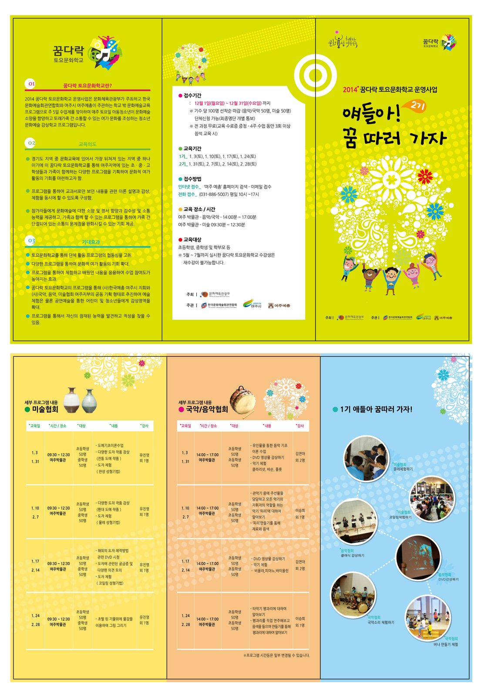

꿈다락 토요문화학교 ^얘들아! 꿈다러가자^  4~5기 수강생을 모집합니다. - 접수기간 : 12월 1일~ 12월 31일까지 - 교육기간   4기 : 1.3 / 1.10 / 1.17 / 1.24/총 4회 매주 토요일  5기 : 1.31 / 2.7 / 2.14 / 2.28 / 총 4회 매주 토요일 - 접수방법 : 여주예총 홈페이지 이메일 접수 (les305@naver.com) - 교육장소 &amp; 시간  음악 / 국악 : 여주박물관, 오전 9시30분 ~ 12시30분 (3시간)  미술 : 여주박물관, 오후 2시 ~ 5시 (3시간) - 교육대상 : 초등학생, 중학생 및 학부모 등  * 5월~7월"까지 실시한 토요문화학교 수강생은 재수강이 불가하오니, 이점 양해해 주시기 바랍니다. * 상기 교육은 무료로 진행됩니다. * 상기일정은 변경될 수 있습니다.

